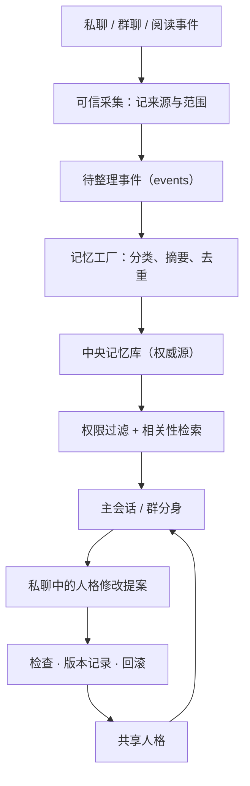

# 01 · 整体架构

## 分层

| 层 | 位置 | 职责 | 换掉会怎样 |
|---|---|---|---|
| 宿主 | DSH（本地 profile） | 会话、模型、工具、插件 | 换宿主 = 重建大半，慎重 |
| 人格 | 插件里的 `systemPrompt.section` | 决定「它是谁」 | 换人格 = 换人 |
| 记忆 | 本地 SQLite + 向量 | 决定「它记得什么」 | 换记忆 = 失忆 |
| 桥 | QQ 桥接进程 | 对外收发、分条、潜水 | 换桥 = 换窗口，本体不动 |
| 主动性 | 定时任务 + 唤醒 | 决定「它什么时候开口」 | 可关可调，不影响本体 |
| 成本闸 | 峰谷判定 | 决定「贵的时段闭不闭嘴」 | 纯策略，随时改 |

**核心判断**：宿主、人格、记忆是本体；桥、主动性、成本闸是外层。
外层坏了不影响本体，本体坏了才是真出事。

## 会话模型

- 每个 QQ 群 → 一个独立的 DSH 会话（「分身」）
- QQ 私聊 → 主会话（或一条独立的轻会话，看你怎么配）
- 桌面对话 → 主会话

分身之间不共享上下文，也不共享记忆写入。想共享就显式共享（同一个 scope），不要默认打通。

## 一条消息走完的路

```
QQ 消息
  → 桥接收（白名单校验）
  → 写进会话的未读 + 记忆服务的 events（scope 隔离）
  → 决定要不要唤醒（@ / 名字 / 关键词 / 提问 / 概率 / 拍一拍）
  → 唤醒时：记忆按 scope 召回 → 拼进提示词
  → 模型生成 → 用发送工具发回 QQ
  → 回合结束，用量写进 token-usage.jsonl
```

## 完整数据流程



五段职责：

| 段 | 谁做 | 产出 | 边界 |
|---|---|---|---|
| 采集 | 可信采集器（桥） | events | 只记来源与范围，不做判断 |
| 整理 | 记忆工厂（后台） | memories | 模型的摘要只是**候选**，范围由程序定 |
| 存储 | 中央库 | 权威记忆 | 单一权威，投影只读 |
| 检索 | 注入/查询 | 提示词片段 | 按 scope + 授权过滤 |
| 人格修改 | 私聊 + 检查 + 版本 | 新的人格版本 | 独立流程，可回滚 |

> 关键一句：**模型整理出来的东西是候选内容**，来源、权限、可写范围由程序确定，
> 不是由摘要模型自己宣布「这条可以进本体」。

## 踩过的坑（模板里直接标出来）

1. **桥接的端口会变**。DSH 桌面版每次启动随机端口，桥必须重新发现端口；写死端口的桥一定会「莫名断线」。
2. **配置分两种**：启动时读的和每条消息读的。改完不生效，先问是哪一种。
3. **DSH 重启会带走子进程**。守护进程必须挂在计划任务/登录项，不能挂在 DSH 的进程树下。
4. **同一件事只能有一条路**。两个桥同时绑同一个会话，就会出现「一条消息两个回复」。
5. **每条消息都做重活会撞锁**。整理、索引这类活放后台，别放在请求路径里。
